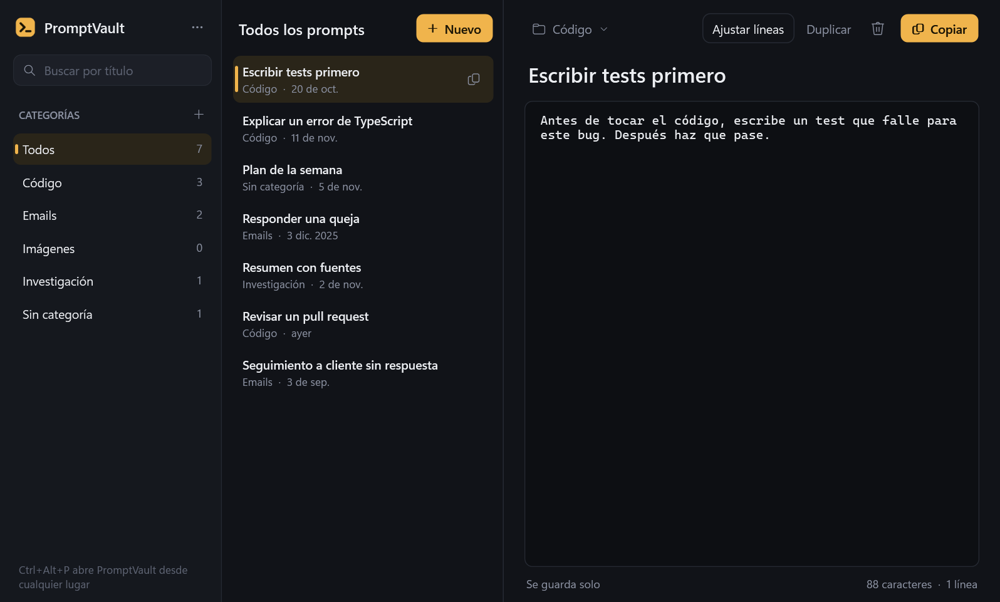
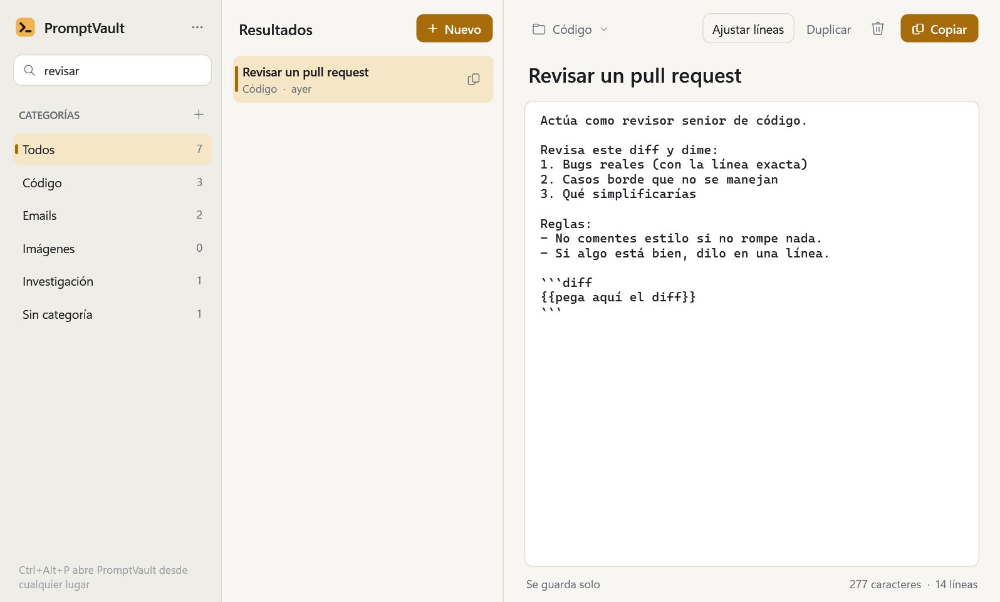

# PromptVault

Gestor de prompts para Windows, ligero y siempre a mano. Vive en la bandeja del sistema, arranca con Windows y se abre con **Ctrl+Alt+P** desde cualquier aplicación.

*A lightweight prompt manager for Windows. It lives in the system tray, starts with Windows and opens with Ctrl+Alt+P. Interface in Spanish.*



## Descargar

1. Ve a [**Releases**](../../releases/latest) y descarga `PromptVault.exe`.
2. Guárdalo donde quieras (por ejemplo en `%LOCALAPPDATA%\Programs\PromptVault\`) y ábrelo.

No necesita instalación ni dependencias: funciona en Windows 10 (versión 1903 o posterior) y Windows 11, que ya traen .NET Framework 4.8.

> Windows SmartScreen puede mostrar "Windows protegió su PC" porque el ejecutable no está firmado digitalmente. Haz clic en **Más información → Ejecutar de todas formas**. También puedes compilarlo tú mismo desde el código (ver abajo).

## Funciones

- **Categorías**: crea, renombra y elimina las que quieras. Al borrar una categoría, sus prompts no se pierden: pasan a *Sin categoría*.
- **Prompts de texto ilimitado** en una caja de código monoespaciada que respeta saltos de línea y tabulaciones.
- **Búsqueda por título**: no distingue mayúsculas ni tildes, y las palabras pueden ir en cualquier orden.
- **Copiar con un clic**: copia el texto completo al portapapeles.
- **Duplicar**, **exportar** e **importar** (backup en JSON).
- **Tema claro / oscuro** automático según Windows, o fijo.
- **Guardado automático y seguro**, con copia de respaldo diaria.
- **Consumo mínimo en segundo plano**: la ventana se crea al abrirla y se libera al cerrarla.



## Atajos

| Acción | Atajo |
|---|---|
| Abrir / esconder PromptVault | `Ctrl+Alt+P` (global) |
| Buscar | `Ctrl+F`. Luego `↑` `↓` para elegir y `Enter` para copiar |
| Copiar el prompt actual | `Ctrl+Enter` |
| Nuevo prompt | `Ctrl+N` |
| Duplicar | `Ctrl+D` |
| Esconder la ventana | `Esc` |

Clic derecho sobre una categoría o un prompt muestra más opciones. Para salir por completo usa el menú `⋯` o clic derecho en el icono de la bandeja → **Salir**.

## Tus datos

Todo se guarda localmente en `%APPDATA%\PromptVault\`; nada sale de tu PC.

| Archivo | Contenido |
|---|---|
| `prompts.json` | Prompts, categorías y ajustes |
| `prompts.json.bak` | Versión anterior al último guardado |
| `backups\prompts-AAAA-MM-DD.json` | Una copia por día (se conservan 7) |

Cada guardado escribe primero un archivo temporal, lo fuerza al disco y luego reemplaza el original de forma atómica. Un corte de luz no deja el archivo a medias. Si el archivo principal se daña, PromptVault lo recupera desde la copia más reciente y te avisa.

## Inicio con Windows

Se activa la primera vez que abres la app. Se desactiva desde el menú `⋯` → *Iniciar con Windows* o desde el menú de la bandeja. Usa la clave `HKCU\Software\Microsoft\Windows\CurrentVersion\Run`, así que no requiere permisos de administrador.

## Compilar desde el código

No hace falta instalar nada: el script usa el compilador de .NET Framework 4.8 incluido en Windows.

```powershell
git clone https://github.com/davidcostacv/prompt-vault.git
cd prompt-vault
powershell -ExecutionPolicy Bypass -File .\build.ps1
```

El script corre las pruebas y, si pasan, genera `dist\PromptVault.exe`.

| Opción | Qué hace |
|---|---|
| `-TestsOnly` | Solo corre las pruebas |
| `-Install` | Copia el ejecutable a `%LOCALAPPDATA%\Programs\PromptVault\` y lo abre |

### Opciones de línea de comandos

| Opción | Qué hace |
|---|---|
| `--tray` | Arranca oculta en la bandeja (la usa el inicio con Windows) |
| `--exit` | Cierra la instancia en ejecución, guardando antes |
| `--data <carpeta>` | Usa otra carpeta de datos |

## Licencia

[MIT](LICENSE)
